# POS Provider Digital Receipt Integration

## Status and purpose

This document defines an implementation plan for receiving completed retail receipts through a retailer's POS/billing-software provider and delivering them to BHive customers. It is an architecture and delivery plan; it does not authorize or describe a production integration with any specific retailer or POS provider.

The initial use case is a retailer such as DMart using a POS provider as the technical integrator. The retailer remains the merchant and source of the transaction. The POS provider authenticates to BHive and sends receipts for the retailer's participating outlets.

### Implementation snapshot (2026-11-09)

The first implementation is present in the Spring Boot modular monolith, but it is not production-ready and does not yet implement the full target architecture below.

| Area | Implemented now | Still pending |
|---|---|---|
| Partner onboarding | Partner application with Ed25519 proof of key possession; active BHive admins can approve or reject it. Approval creates an active integration for the submitted retailer/outlet and public key. | Due diligence and retailer authorization, production/sandbox separation, multi-outlet scopes, quotas, credential rotation/revocation operations, and provider certification. |
| Receipt submission | Signed `POST /api/v1/partner/receipts`; validates the active integration/outlet, request fields, timestamp, nonce, and idempotency/source IDs; stores receipt and line items. | OpenAPI contract, transactional outbox, durable queue, worker, DLQ/replay, and asynchronous document processing. |
| Customer delivery | Five-minute, one-use QR link tokens; email/phone matching against linked customer profiles in development/local; customer receipt inbox and per-channel preferences; in-app notification on a newly stored receipt. | Contact verification/OTP before production matching, wrong-receipt reporting, document access, and notification delivery beyond the in-app feed. |
| Corrections and operations | None of the refund/void/callback workflow is implemented. | Source events, reconciliation, callbacks, monitoring/alerts, runbooks, load/failure testing, and controlled partner rollout. |

Partner receipt notifications are currently written synchronously in the receipt transaction; they are not dispatched through a queue. Contact matching is enabled by default for development/local profiles, including existing profiles after migration, and is disabled in production until contact verification is implemented. The temporary `/dev/receipt-sender` page is available only in development builds to authenticated admins; it is not a production partner portal.

Database changes are currently supplied as manual SQL under `docs/database/migrations/`; Flyway is not configured. Production uses Hibernate schema validation, so apply the receipt SQL migrations in dependency order before deploying. Do not treat the presence of a dated SQL file as an automatically applied migration.

## Goals

- Reliably accept receipts without delaying checkout.
- Deliver receipts only to a BHive customer who intentionally linked the transaction.
- Support multiple POS providers, retailers, outlets, and contract versions.
- Preserve the receipt as supplied by the source, with an auditable history for corrections.
- Protect customer, transaction, and integration data across tenants and partners.
- Start as a modular extension to BHive's Spring Boot modular monolith, with independently scalable workers and managed infrastructure where needed.

## Non-goals for the first release

- Creating or issuing invoices on behalf of the retailer.
- Processing payments, storing payment credentials, or changing the POS payment flow.
- Replacing the retailer's accounting, GST, or point-of-sale records.
- Automatically creating BHive accounts for people who are not BHive customers.
- Giving a POS provider access to a customer's BHive profile, purchase history, or other retailers' receipts.
- Building an open marketplace for arbitrary receipt senders before partner onboarding and controls exist.

## Existing BHive architecture and design boundary

BHive is currently documented as a Spring Boot/Java and React/TypeScript modular monolith, with MySQL, Redis, and S3. External receipts should be a separate domain from BHive-issued invoices. Existing invoices represent an invoice issued by a BHive business; a retailer receipt is a purchase record sent by an external merchant, with different ownership, status, and lifecycle.

Receipt records are platform/customer-owned, not owned by a BHive business tenant. A partner can submit a receipt only for the retailer and outlets enabled for its integration. A customer can access only receipts linked to the authenticated global BHive user. Do not add a retailer as a BHive business or create a business-customer relationship just to store a receipt.

## Actors and trust boundaries

| Actor | Responsibility | Must not be trusted to |
|---|---|---|
| Customer | Intentionally links a checkout to their BHive account and views receipts | Supply authorization for another customer |
| Retailer | Owns the sale and original receipt; approves participation and outlets | Access other retailers' integrations or customer accounts |
| POS provider/integrator | Transforms the POS transaction to BHive's versioned contract and delivers it | Choose arbitrary customer IDs or browse BHive users |
| BHive Partner API | Authenticates integrations, validates and records submissions | Treat partner-provided fields as authorization |
| Receipt worker | Processes committed receipt events and triggers delivery | Duplicate side effects on message retries |
| BHive customer API/UI | Lists and displays a customer's receipts | Accept customer identity from request parameters |
| Document storage | Stores original digital receipt documents privately | Serve public or unvalidated content |

## Target architecture

```mermaid
flowchart LR
    POS[Retailer POS] -->|sale completed| Provider[POS provider / integrator]
    App[BHive customer app] -->|short-lived receipt-link token| CustomerAPI[BHive customer API]
    CustomerAPI --> TokenStore[(Link token store)]
    Provider -->|TLS + partner authentication + idempotency key| Edge[WAF / load balancer / partner API]
    Edge --> Ingest[Receipt ingestion module]
    Ingest -->|one database transaction| DB[(MySQL: receipt + outbox)]
    Outbox[Outbox publisher] --> Queue[Managed durable queue]
    DB --> Outbox
    Queue --> Worker[Receipt processing worker]
    Worker --> DB
    Worker -->|private upload / generated signed URL| S3[(Private object storage)]
    Worker --> Notify[Notification service]
    Notify --> App
    App -->|customer-authenticated read| CustomerAPI
    CustomerAPI --> DB
    Provider -.->|optional status callback| Callback[Partner webhook endpoint]
```



### Deployment shape

1. Keep partner authentication, receipt validation, customer receipt APIs, and persistence in the existing modular monolith initially. Use separate application services and repository boundaries for the receipt domain.
2. Run queue workers as a separately scalable process/deployment so document scanning and notification retries cannot block API request threads.
3. Use a durable managed queue (AWS SQS is a suitable AWS option) with a dead-letter queue. Add an outbox publisher so database commits and queue publication cannot silently diverge.
4. Put public integration endpoints behind a managed edge with TLS, WAF rules, request-size limits, and shared rate limiting. Do not rely on the current in-memory, per-instance limiter for partner protection.
5. As traffic grows, run stateless API instances behind a load balancer and scale workers independently. Keep MySQL as the system of record; assess connection pooling, backups, restore drills, and database capacity before increasing concurrency.
6. Store receipt documents in a private S3 bucket with encryption, restricted IAM access, and short-lived signed download URLs. Do not make receipt objects public.

## End-to-end flows

### 1. Partner onboarding and outlet activation

1. **Pending operationally:** BHive performs partner due diligence and records a contract owner and operational/security contacts.
2. **Pending:** the retailer authorizes the POS provider to submit receipts for specified retailers and outlets. The current application records one retailer/outlet pair.
3. **Implemented:** the partner generates an Ed25519 key pair locally and submits the public key plus a proof signature with its application. The private key must never be submitted to BHive.
4. **Implemented with limited scope:** an active BHive admin approves or rejects the application. Approval creates one active integration for the submitted retailer/outlet and public key. A status token is returned for checking the application status.
5. **Pending:** provider sandbox contract tests, security verification, retry testing, and pilot reconciliation. The local development sender is only a temporary test tool, not a partner sandbox.
6. **Pending for production:** separate sandbox/production integration records, an explicit activation process, key rotation/revocation operations, and rapid outlet suspension.

### 2. Customer checkout linking

1. An authenticated customer chooses to receive a digital receipt and displays a BHive-generated, opaque, short-lived receipt-link token in the app.
2. The current token is random, stored server-side only as a keyed hash, bound to the authenticated user and tenant, expires after five minutes, and is one-use. It is not currently bound to a specific integration.
3. The POS scans the token. The provider includes it in the receipt submission after the sale is committed.
4. In one transaction, BHive validates and consumes the token while inserting the receipt. A token cannot be reused for a second receipt. The current implementation does not create an outbox event.
5. If the POS cannot scan a QR, the current API can match an email or phone saved on a linked customer profile. Matching is enabled by default in development/local and can be disabled per channel. Production matching remains disabled until contact verification is implemented.
6. If the buyer does not have a BHive account or does not present a valid token, do not persist a customer-linked receipt or send an unsolicited invitation. Any future invitation flow needs a separate consent and retention design.

### 3. Receipt ingestion and delivery

1. **Implemented:** the provider sends a receipt after the sale is committed. The API authenticates the integration, checks its active retailer/outlet, validates the request, and applies database-backed nonce and idempotency/source-ID checks.
2. **Implemented synchronously:** BHive stores the receipt and its line items in the same request transaction. A newly stored receipt also creates an in-app notification in that transaction. The current response is `201 Created` for a new QR-linked receipt, `202 Accepted` for contact-based delivery with an eligible match, `422 Unprocessable Entity` when no eligible contact match exists, and `409 Conflict` for any duplicate idempotency key or external receipt ID (including an exact retry).
3. **Pending:** an outbox publisher, durable queue, worker, document scanning/storage, and retry/DLQ handling. Receipts are currently available immediately after persistence; there is no asynchronous processing state.
4. **Partially implemented:** the authenticated customer receipt inbox displays receipt details and line items. Original receipt documents and a per-receipt customer detail/download endpoint are not implemented.
5. **Pending with the worker architecture:** at-least-once queue processing, idempotent worker side effects, and recovery/replay operations. Request-level idempotency is implemented.
6. **Pending:** partner status callbacks. No user identity or profile data should be returned to a partner.

### 4. Refunds, voids, and corrections

- Represent a refund, void, or correction as a new immutable source event that references the original source receipt.
- Enforce uniqueness on `(integration_id, outlet_id, external_event_id)` and validate that the referenced receipt belongs to the same integration and outlet.
- Keep original receipt data and correction history. Derive a current display state from accepted events; never silently replace the source receipt.
- If an event arrives before its original receipt, store it as pending reconciliation or return a retryable response according to the agreed provider contract. Do not discard it.

## API contract plan

Use a distinct partner API namespace and version it independently from customer APIs:

### Current implemented API

The current paths and contract differ from the target endpoints and payload below:

| Purpose | Current endpoint |
|---|---|
| Submit a partner application | `POST /api/v1/pos-partner-applications` |
| Check application status | `GET /api/v1/pos-partner-applications/{applicationId}/status` with `X-Application-Access-Token` |
| Admin list/approve/reject applications | `GET /api/v1/admin/pos-partner-applications`, `POST .../{applicationId}/approve`, `POST .../{applicationId}/reject` |
| Submit a receipt | `POST /api/v1/partner/receipts` |
| Create a customer receipt-link token | `POST /api/v1/customer/receipt-link-tokens` |
| List customer receipts and manage contact preferences | `GET /api/v1/customer/receipts`, `GET/PUT /api/v1/customer/receipts/preferences` |

Receipt requests require `X-Partner-Id`, `X-Partner-Timestamp`, `X-Partner-Nonce`, `X-Partner-Signature`, and `Idempotency-Key`. The partner signs the exact raw request body with the approved Ed25519 private key. The signed prefix is:

```text
BHIVE_POS_RECEIPT_V1
POST
/api/v1/partner/receipts
{partnerId}
{timestamp}
{nonce}
{idempotencyKey}
```

The signature covers the UTF-8 bytes of that prefix, including its final newline, followed by the exact raw body bytes. The timestamp must be an ISO-8601 UTC instant within five minutes of server time. Nonces are durably recorded and cannot be reused.

The current JSON DTO uses `externalReceiptId`, `receiptNumber`, exactly one of `customerLinkToken` / `customerEmail` / `customerPhone`, `retailerReference`, `outletReference`, `transactionAt`, `currency`, `totalAmount`, and `items`. Each item has `productName`, `quantity`, `unitPrice`, and `lineTotal`. `transactionAt` must parse as an ISO-8601 instant; send UTC timestamps in `Z` form. Requests are limited to 1 MiB and 100 line items. The current contract does not include `schemaVersion`, tax/discount breakdowns, or receipt-document uploads.

For the sender request example and retry procedure, see the [POS Provider Sender Quickstart](pos-provider-sender-quickstart.md). The target endpoints in the following table are proposals; do not use them as the current API contract.

| Purpose | Proposed endpoint |
|---|---|
| Create/submit a receipt | `POST /api/partner/v1/receipts` |
| Upload a receipt document | `POST /api/partner/v1/receipt-documents` |
| Submit a refund, void, or correction | `POST /api/partner/v1/receipt-events` |
| Read limited processing status | `GET /api/partner/v1/receipts/{partnerReceiptId}/status` |
| Customer receipt list | `GET /api/v1/customer/receipts` |
| Customer receipt detail | `GET /api/v1/customer/receipts/{receiptId}` |
| Create one-time receipt-link token | `POST /api/v1/customer/receipt-link-tokens` |

Partner endpoints must not reuse customer bearer-token authorization. Customer endpoints must not accept a customer/user ID as an authorization input; derive the identity from BHive's verified authentication context.

### Proposed future receipt request shape (not the current DTO)

The final schema must be agreed with the POS provider. A future contract could use a versioned, allow-listed DTO containing:

```json
{
  "schemaVersion": "1",
  "retailerReference": "retailer-123",
  "outletReference": "outlet-456",
  "externalReceiptId": "receipt-789",
  "transactionTime": "2026-11-09T10:42:18+05:30",
  "currency": "INR",
  "receiptLinkToken": "opaque-one-time-value",
  "amounts": {
    "subtotal": "1000.00",
    "discount": "50.00",
    "tax": "171.00",
    "total": "1121.00"
  },
  "items": [
    {
      "description": "Product description",
      "productReference": "optional-source-sku",
      "quantity": "2.000",
      "unitPrice": "500.00",
      "taxRate": "18.00",
      "taxAmount": "171.00",
      "lineTotal": "1121.00"
    }
  ],
  "document": {
    "uploadId": "optional-prior-upload-id",
    "mediaType": "application/pdf",
    "sha256": "hex-encoded-content-digest"
  }
}
```

This is illustrative, not the finalized API schema. Use decimal strings or exact decimal JSON numbers mapped to `BigDecimal`, never binary floating-point money. The API must define rounding, inclusive/exclusive tax treatment, discount allocation, item-versus-header reconciliation, timestamp/timezone handling, maximum item count, and optional fields. Do not accept arbitrary JSON fields for persistence.

### Target response and error semantics

- Target: return `202 Accepted` with a BHive receipt ID and `received` status once the receipt and outbox event are durably committed. The current implementation instead returns the statuses documented in the current API section above.
- Any previously used idempotency key or external receipt ID returns `409 Conflict`, including an exact retry. After a timeout, a partner must reconcile a possible prior acceptance before interpreting `409` as a failed sale; a receipt lookup/status endpoint remains pending.
- A well-formed contact with no eligible linked profile returns a generic `422`; malformed contact values return `400`; contact matching disabled by server configuration returns `409`.
- Use `400` for malformed/schema-invalid requests, `401/403` for invalid credentials or out-of-scope retailer/outlet, `409` for idempotency/source conflicts, `413` for size limits, and `429` for rate limits.
- Do not reveal whether a customer account or token belongs to a particular person. Use generic errors for unknown, expired, or already-consumed link tokens.
- **Privacy trade-off:** returning `202` for eligible contacts and `422` for unmatched/opted-out/ambiguous contacts lets an authenticated partner infer contact eligibility. Production contact matching stays disabled until contact verification and privacy review are complete; if eligibility must remain confidential, use the same acknowledgement status for both cases instead.
- Define which errors are retryable. Return `Retry-After` for temporary throttling or service unavailability; document exponential backoff and jitter for the provider.

### Partner callbacks (optional)

If the partner needs post-acceptance status, configure an HTTPS callback URL during onboarding and deliver signed, minimal events. Validate callback URLs at onboarding, block private/link-local/metadata IP ranges, and revalidate DNS/redirect behavior to prevent SSRF. Prefer an allow-listed partner domain. Sign callbacks, include a timestamp and unique event ID, retry with bounded exponential backoff, and provide replay-safe event IDs. Do not make callbacks a dependency for receipt acceptance.

## Domain model and persistence

Names below describe the logical model; final table names and migration conventions should follow the repository's database conventions.

The current first release uses `pos_integrations`, `pos_partner_applications`, `receipt_link_tokens`, `receipt_partner_nonces`, and `external_receipts`. Receipt items are stored as JSON on the external receipt record. There are no current tables for document metadata, refund/void events, delivery events, idempotency records, or outbox events; these remain target architecture.

| Entity | Important fields and invariants |
|---|---|
| `pos_partner` | Provider identity, status, support contacts, credential lifecycle metadata; no shared secret in plaintext |
| `retailer` | External merchant reference, display identity, onboarding/status; separate from BHive business tenants |
| `retailer_outlet` | Retailer-scoped external outlet reference, display/location metadata, active state |
| `pos_integration` | Partner, retailer, contract version, allowed outlets, scopes/quotas, credential key reference, status |
| `receipt_link_token` | Keyed token hash, global BHive user ID, allowed integration if configured, expiry, consumed receipt/time; never persist raw token |
| `digital_receipt` | UUID, recipient user ID, integration/retailer/outlet, external receipt ID, original transaction time/offset, normalized UTC time, currency, exact amounts, processing state, document key/digest, schema version |
| `digital_receipt_item` | Receipt ID, source item reference, description snapshot, exact quantity/unit/tax/line amounts, stable item order |
| `receipt_source_event` | Immutable external refund/void/correction event ID, original receipt reference, type, effective timestamp, source payload digest, processing result |
| `receipt_delivery_event` | Receipt ID, event type, timestamp, attempt/status, minimal diagnostic code; no raw secrets or unnecessary PII |
| `integration_idempotency` | Integration-scoped key, request digest, resulting receipt ID/response metadata, creation and expiry time |
| `outbox_event` | Event type, aggregate ID, payload/version, creation/publish/attempt state for reliable queue publication |

Required database protections:

- Unique `(integration_id, outlet_id, external_receipt_id)` for receipts and `(integration_id, external_event_id)` for source events.
- Index customer receipt queries by `(recipient_user_id, transaction_time, id)` and partner reconciliation by `(integration_id, created_at, id)`.
- Enforce foreign keys and restrictive deletion for retailer, outlet, integration, and receipt relationships.
- Use optimistic locking or equivalent safeguards for concurrent state transitions and token consumption.
- Store UTC instants and retain the source offset or source timestamp for faithful receipt display/audit.
- Keep platform-owned receipt data separate from tenant-owned BHive business invoices. Authorization checks must use the authenticated user and receipt ownership, not a caller-supplied tenant ID.
- Use additive schema migrations and explicit retention/deletion handling. Hibernate schema validation must succeed after migrations are applied.

## Security controls

### Partner authentication and authorization

- Require TLS 1.2+ for all partner traffic; reject plaintext and weak transport configurations.
- **Implemented:** each approved integration has its own Ed25519 public key, and receipt requests are signed over the timestamp, nonce, method/path, idempotency key, and exact raw body. Partner applications prove possession of the submitted public key.
- **Pending:** separate credentials per environment, key rotation/revocation operations, and any OAuth/mTLS option. The current protocol is not OAuth or HMAC.
- If HMAC is used, protect keys with AWS Secrets Manager/KMS-backed controls, never log or return keys, support overlap during rotation, and revoke compromised keys promptly.
- Enforce integration scopes in backend authorization: partner, retailer, and outlet are taken from the authenticated integration record, not trusted from request fields.
- Add mTLS for high-volume or higher-assurance partners where operationally supported.
- **Implemented:** signed request timestamps are bounded to five minutes and nonces are persisted with a uniqueness check. Shared edge rate limiting, integration/outlet quotas, concurrency controls, and anomaly alerts remain pending.
- Apply per-integration and per-outlet quotas, payload limits, concurrency limits, and anomaly alerts. Use a shared limiter or managed edge rather than a per-instance counter.

### Customer identity and consent

- A receipt-link token is opaque, high entropy, short-lived, single-use, and stored only as a keyed hash. Bind it to the authenticated user, expiry, consent purpose, and permitted integration where possible.
- Consume the token and attach the receipt atomically. Prevent race conditions with a database constraint/locking strategy.
- Never persist the raw token in the receipt, source payload archive, outbox, queue message, audit record, or logs. If a source payload copy is retained, redact the token before persistence and retain only the request digest and resolved recipient binding.
- Do not expose a customer lookup, account-existence check, or receipt search API to a partner.
- Customer receipt reads must verify authenticated user ownership on every request. UUIDs are identifiers, not authorization.
- Provide clear customer controls for receipt notifications, reporting a wrong link, and account/receipt privacy requests. Avoid sending the full receipt or product list in push notification text.

### Document and payload handling

- Prefer BHive-issued pre-signed upload URLs or a controlled upload endpoint. Do not have the backend fetch arbitrary document URLs supplied by a partner; this avoids SSRF and uncontrolled data egress.
- Require allowed media types, file-size/page limits, content sniffing, checksums, and malware scanning/quarantine before customer download.
- Keep the object bucket private, block public access, encrypt at rest and in transit, scope IAM to the required prefix/actions, and use short-lived customer-authorized download URLs.
- Escape/sanitize text before rendering; treat receipt descriptions, URLs, filenames, and PDF metadata as untrusted input.
- Do not accept or store PAN, CVV, UPI PIN, authentication secrets, or full payment credentials. Payment method, if needed, should be a non-sensitive category only.

### Application, secrets, and operational security

- Validate all fields at the API boundary, then validate business invariants in a domain service. Use parameterized persistence and bounded pagination.
- Keep secrets out of source, client bundles, logs, exception messages, and test fixtures. Use AWS Secrets Manager/IAM and environment-specific credentials.
- Use least-privilege service identities for API, worker, queue, and document storage.
- Audit partner onboarding, credential issue/rotation/revocation, outlet changes, user receipt access, and administrative actions. Never log raw tokens, auth headers, full request bodies, or unredacted documents.
- Apply dependency scanning, static analysis, secret scanning, security-focused tests, and a partner threat-model review before production.
- Align notices, consent, data-subject request handling, and retention with applicable Indian privacy law and obtain legal review before launch; this document is not legal advice.

## Reliability, scaling, and observability

- Use the transactional outbox pattern: receipt and outbox event commit together, and a publisher retries delivery to the queue.
- Assume at-least-once message delivery. Use receipt/event IDs as idempotency keys in workers and notification dispatch.
- Configure bounded retries with exponential backoff and jitter, a dead-letter queue, replay tooling, and alerts. Replay must preserve deduplication and must not resend notifications unintentionally.
- Separate ingestion latency from asynchronous processing. Keep PDF scanning, storage, and notification work out of the API request path.
- Add timeouts and concurrency limits for downstream notification and storage calls.
- Track metrics by integration ID (not customer PII): requests, auth failures, schema rejects, duplicate requests, queue age/depth, processing latency, document scan failures, delivery outcomes, retries, and DLQ count.
- Use correlation IDs across API, database/outbox, queue, worker, and notification logs. Redact personal and financial data.
- Initial proposed launch targets, to be validated against partner peak volumes and infrastructure:
  - Partner acknowledgement p95 under 500 ms during normal load.
  - 95% of valid receipts visible to the customer within 60 seconds; 99% within 5 minutes, excluding customer-device push delivery delays.
  - Zero lost accepted receipts during worker restart, queue redelivery, or application deployment.
  - No duplicate customer receipt from any documented partner retry scenario.
  - Alert on sustained queue age, DLQ messages, elevated 4xx/5xx rates, or anomalous integration traffic.
- Load test at twice the agreed peak partner rate and test recovery from database/queue/worker interruptions before production.

## Privacy, retention, and audit

- Collect only receipt and recipient data needed to deliver and support the receipt. Define purpose, notice, consent evidence, and data retention with legal/compliance review.
- Define separate retention for raw partner payloads, normalized receipts, source documents, security logs, and idempotency records. Do not retain all raw payloads indefinitely by default.
- Maintain a deletion/retention workflow that accounts for legal holds and required audit records without leaving unnecessary customer identifiers in logs or analytics.
- Keep immutable integrity metadata (source IDs, timestamps, document digest, correction history) while controlling access to the receipt content itself.
- Explain to users that a BHive copy is for their records and does not replace the retailer's system of record or establish that a document is a GST-compliant tax invoice.

## Testing and acceptance gates

### Contract and integration tests

- Publish OpenAPI specification, examples, field constraints, error semantics, signature algorithm, idempotency behavior, and retry guidance.
- Run provider contract tests in a sandbox with synthetic customers and receipts; prohibit production customer data in sandbox.
- Test supported schema versions and reject unsupported versions without partial writes.
- Verify total/tax/discount reconciliation, decimal precision, timestamp offsets, Unicode item descriptions, empty/large item arrays, and invalid documents.

### Security and authorization tests

- Invalid, revoked, expired, wrong-environment, and wrong-scope credentials are rejected.
- Partner A cannot submit for Partner B's retailer/outlet or query another partner's receipts.
- Customer A cannot list, read, download, or mutate Customer B's receipts, even with a guessed receipt UUID or modified request.
- Expired, replayed, consumed, cross-user, and wrong-integration link tokens cannot attach a receipt.
- Signature replay, body tampering, duplicate keys, oversized bodies, content-type spoofing, unsafe redirects, and SSRF attempts are rejected safely.
- No credentials, raw tokens, or unnecessary PII appear in application, queue, audit, or error logs.

### Resilience and correctness tests

- Duplicate idempotency keys and external receipt IDs return `409` and do not create a second receipt or notification.
- Unknown, opted-out, or ambiguous phone/email contacts return `422` and do not create a receipt or notification.
- Database commit followed by publisher/queue failure is recovered by the outbox.
- Duplicate and out-of-order queue messages do not duplicate receipt state or notifications.
- Worker restart, queue redelivery, dead-letter replay, notification outage, and document scan outage recover without losing accepted records.
- Refund/void events are idempotent, linked to the correct source receipt, and preserve the original.
- Migration is tested on a production-like MySQL schema, with backup/restore and rollback/recovery procedures documented.

### Launch gates

- Partner contract, retailer authorization, privacy/legal review, and customer consent copy approved.
- OpenAPI contract and sandbox certification passed by the POS provider.
- Production credentials, rotation/revocation process, alert routing, support contacts, and runbooks verified.
- Load, failure-injection, security, and end-to-end customer tests pass.
- Initial pilot reconciliation shows all POS receipts accepted by BHive match partner counts, including duplicates, rejects, refunds, and voids.

## Delivery plan

| Phase | Deliverables | Status and remaining exit criteria |
|---|---|---|
| 0. Partner discovery | Confirm POS capabilities, trigger timing, identifiers, item/tax fields, document format, volume/peak, retry behavior, refund/void events, identity capture, and support ownership | **Pending:** select and contract with a real provider/retailer; approve data contract, retailer authorization, privacy, and threat-model reviews. |
| 1. Foundations | Receipt domain, migrations, partner/integration registry, credential lifecycle, OpenAPI spec, sandbox, shared throttling/edge plan | **Partially implemented:** application/approval, integration records, Ed25519 authentication, and authorization tests exist. **Pending:** OpenAPI, due diligence/contract workflow, credential lifecycle, sandbox separation, and shared edge/rate limiting. |
| 2. Durable ingestion | Partner endpoint, request validation, unique source keys, durable idempotency, outbox, queue, worker, DLQ and replay operations | **Partially implemented:** signed endpoint, validation, durable nonces, idempotency/source-ID checks, and receipt persistence. **Pending:** outbox, queue, worker, DLQ/replay, and failure/load tests. |
| 3. Customer delivery | Short-lived link token, customer receipt list/detail, line items, private document access, notifications, report-wrong-receipt path | **Partially implemented:** QR token, development/local contact matching with opt-out controls, receipt inbox, line items, and in-app notification. **Pending:** production contact verification/OTP, documents, wrong-receipt reporting, and complete end-to-end provider certification. |
| 4. Corrections and operations | Refund/void events, optional signed status callback, reconciliation dashboard/report, alerts and support runbooks | **Pending:** no correction/event or callback workflow exists yet. |
| 5. Controlled rollout | Staff/internal pilot, limited outlet pilot, monitored expansion by retailer/outlet | **Pending:** no real provider pilot, reconciliation, SLO review, or production rollout has occurred. |

Roll out by feature flag and integration/outlet allow-list. Begin with a small pilot, compare partner and BHive counts daily, and expand only after reconciliation and operational metrics are stable. A kill switch must stop new submissions for a compromised integration or outlet without deleting already accepted receipts. Rollback must preserve accepted data and avoid duplicate delivery when re-enabled.

## Open decisions and approvals before production

1. Which POS provider and retailer will be the first pilot, and which legal entity signs the data-processing/integration agreement?
2. Can the selected provider scan the BHive QR/token at checkout? Email/phone matching is implemented as a development/local alternative, but its production use requires verified contacts and appropriate consent/legal approval.
3. Which receipts are in scope: all purchases, selected outlets, or selected sales channels? Are refunds, voids, and exchanges available as separate events?
4. Must BHive store a PDF/image, or are structured receipt details sufficient for the first release?
5. What are the provider's expected daily volume, peak requests/second, maximum receipt size, retry policy, and delivery latency?
6. The customer preference controls and in-app notification are implemented. Consent wording, verified-contact policy, receipt retention/deletion behavior, and legal record obligations still require approval.
7. Does the partner need status callbacks or reconciliation exports, and what exact minimum data do they require?
8. What launch availability/latency targets and operational support hours can BHive commit to?

## Recommended first implementation boundary

Implement one POS provider integration with one retailer and a limited outlet allow-list. Build the versioned generic receipt contract and partner registry first, but avoid premature multi-provider UI or marketplace features. Keep the receipt domain, durable idempotency, customer-link token, outbox/queue, private document storage, and customer ownership checks as launch requirements rather than later enhancements.

For a short sender-facing explanation and example request/response flow, see the [POS Provider Sender Quickstart](pos-provider-sender-quickstart.md).
